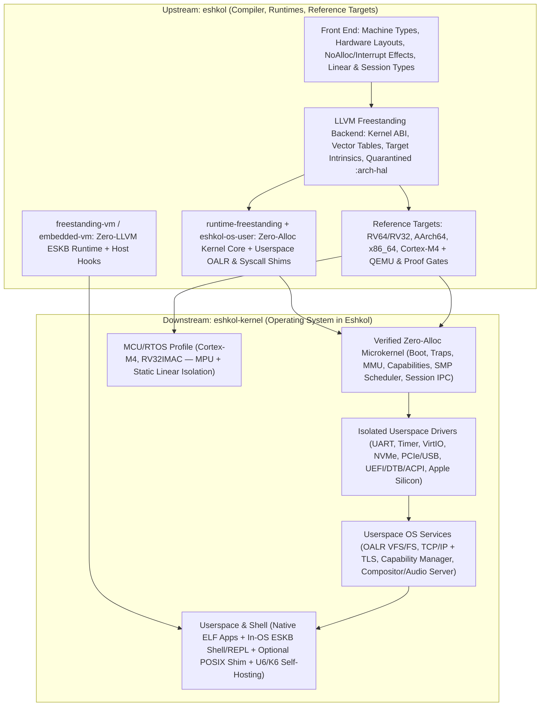
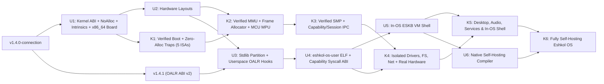

# Eshkol Operating System Enablement Plan

## Purpose

This plan defines the complete compiler, runtime, formal-verification, and downstream kernel program required to build a fully featured, self-contained, capability-based, zero-GC operating system written entirely in Eshkol — spanning 64-bit MMU systems (RISC-V 64, AArch64, x86_64, UEFI PCs, open SBCs, and Apple Silicon) as well as MMU-less microcontrollers (Cortex-M4 and RV32IMAC). It complements [MILESTONES_AND_EXIT_CRITERIA.md](MILESTONES_AND_EXIT_CRITERIA.md), [ROADMAP_ALIGNMENT.md](ROADMAP_ALIGNMENT.md), and [KERNEL_HANDOFF.md](KERNEL_HANDOFF.md), and accelerates execution ahead of the nominal `v1.8.0-platform` / `v1.8.1` calendar targets.

---

## 1. Locked Architectural Decisions

| Axis | Decision |
|---|---|
| **Scope** | Complete, self-contained OS written entirely in Eshkol across both 64-bit MMU targets and MMU-less microcontrollers. |
| **Kernel Architecture** | **Capability microkernel with hardware MMU** — small audited kernel (MMU, traps, scheduler, capability table, zero-copy session-typed IPC); drivers, filesystems, networking, compositor, audio, and shell run as isolated Eshkol userspace processes. |
| **Kernel Memory Model** | **Strictly zero-dynamic-allocation kernel core** (fixed/boot-sized frame, thread, and capability pools, `NoAlloc` everywhere inside the kernel) paired with **full OALR regions in userspace drivers and OS services**. |
| **Target Coverage** | **64-bit MMU microkernel (`freestanding-kernel-native`):** RV64 (`qemu-virt-riscv`) and AArch64 (`qemu-virt-aarch64`) first using existing boards, adding `x86_64` QEMU PC in parallel during U1 so all three 64-bit MMU ISAs stay in lockstep; physical hardware bring-up covers UEFI x86_64 PCs, open AArch64/RISC-V SBCs (DTB/ACPI + PCIe/NVMe/USB), and Apple Silicon (`m1n1`/ADT bare-metal AArch64). **MCU/RTOS profile (`freestanding-mcu-native` + `embedded-vm`):** Cortex-M4 (`mps2-an386` -> STM32/RP2040/ESP32-C3) and RV32IMAC (`qemu-virt-riscv` 32-bit), sharing the same zero-alloc interrupt, layout, and linear/MPU isolation discipline. |
| **Privileged Ops & Inline Assembly** | **Typed `target-intrinsic`** for privileged CPU instructions (CSR/MSR/CRx, TLB/cache flush, `wfi`/`hlt`, port I/O) + **quarantined `:arch-hal` `unsafe-asm`** restricted strictly to per-ISA boot/trap/context-switch modules. |
| **Userspace Syscall ABI** | **Pure native Eshkol capability syscall ABI** at the kernel boundary (zero-copy `submit`/`complete` rings + session-typed IPC), plus an optional userspace POSIX translation library layered above native syscalls for porting C/LLVM tooling. |
| **In-OS Execution & Self-Hosting** | **Native AOT ELF** (`--profile eshkol-os-user`) for all OS services, drivers, and applications + **zero-LLVM `freestanding-vm`/`embedded-vm` (ESKB)** for the in-OS interactive shell, REPL, and scripting in K5; full native in-OS self-hosting (native Eshkol backend or LLVM over the POSIX shim) as Phase U6/K6. |
| **Verification & Assurance Bar** | **Combined executable + formal bar from K1 onward:** every K1–K3 microkernel module requires both QEMU/ICC runtime gates (zero-alloc traps, capability revocation, fault isolation, layout pins, zero-hosted-symbol audits) and machine-checked formal proofs (Lean/Agda/Rocq + Eshkol dependent/refinement/effect/linear/session types) of functional correctness and security invariants before merge. |

---

## 2. Current Platform Baseline (`v1.4.0-connection`)

Milestones A through G of [MILESTONES_AND_EXIT_CRITERIA.md](MILESTONES_AND_EXIT_CRITERIA.md) are already implemented in the tree:

- **Execution profiles (A–B):** All seven profiles in `lib/core/execution_profile.cpp` (`hosted-native`, `hosted-wasm`, `hosted-vm`, `freestanding-kernel-native`, `freestanding-mcu-native`, `freestanding-vm`, `embedded-vm`).
- **Runtime stratification (C):** `runtime-core`, `runtime-hosted`, and the zero-libc bare-metal runtime subset in `lib/platform/embedded/runtime/` (`memory.c`, `start.c`).
- **Low-level language and ELF pipeline (D–E):** Fixed-width machine types (`u8`–`u64`, `i8`–`i64`, `usize`, `isize`, `ptr`), wrapping modular arithmetic, `volatile-load` / `volatile-store!`, atomic operations, `compiler-fence`, `memory-fence`, `target-intrinsic`, C-ABI `:export-symbol`, `:section`, `:align`, `:used`, `:weak`, `:no-return`, `--gc-sections`, and linker-script ELF linking.
- **Reference boards and QEMU execution (F):** Three architectures / five bare-metal targets compile, link, boot under QEMU, and drive UART MMIO via `volatile-store!` (`tests/embedded/fib_checksum.esk`, verified by `embedded_targets_objects` and `embedded_targets_qemu`):
  - Cortex-M4 (`thumbv7em-none-eabi`, `thumbv7em-none-eabihf` on `mps2-an386`)
  - AArch64 (`aarch64-unknown-none` on `qemu-virt-aarch64`)
  - RISC-V 32/64 (`riscv32imac-unknown-none-elf`, `riscv64gc-unknown-none-elf`, `riscv64imac-unknown-none-elf` on `qemu-virt-riscv`)
- **Freestanding and embedded VM (G):** Host-hook ABI, strict ESKB section validation (`D-0074`–`D-0079`), host-native-only dispatch, and closed zero-argument entry admission.
- **Type and platform subsystems already present:** Linear and borrow resource tracking (`--strict-resources`, ADR-0056), dependent types (ADR-0042), refinement types (ADR-0044), effect types and algebraic effects (ADR-0045), row/higher-rank/session types (ADR-0046), HoTT cubical kernel (ADR-0043), and hosted windowing/event/audio/MIDI/Vulkan interfaces.

---

## 3. Non-Negotiable Architectural Invariants

1. **Zero dynamic allocation in the microkernel core (enforced statically via effect types).**
   The entire microkernel core — including all trap and interrupt handlers — compiles under a static `NoAlloc` effect constraint (`ADR-0045`). Kernel objects (page frames, TCBs, capability slots, per-CPU IRQ ring buffers) come from explicit boot-sized or capability-retyped fixed pools. Dynamic OALR regions live in userspace drivers and OS services.
2. **Typed `target-intrinsic` first; quarantined `:arch-hal` stubs only for irreducible ISA transitions.**
   Privileged CPU instructions (CSR/MSR/CRx, TLB/cache maintenance, `wfi`/`hlt`, `eret`/`sret`/`iretq`, x86 port I/O) are typed `target-intrinsic` operations; irreducible `:naked` boot entry and context-switch register saves live strictly inside audited `:arch-hal` modules with no unsafe exports.
3. **Opaque kernel handles; driver-owned hardware layouts.**
   The kernel core operates on linear/borrowed opaque handles (`DeviceRegion`, `IrqLease`, `DmaBuffer`, `PageFrame`), not raw hardware register structs. Declarative `:repr-c` / `:packed` / `:align` hardware layouts live inside driver modules so board and SoC register definitions do not leak into kernel ABI.
4. **Capability-typed, session-typed IPC.**
   Every IPC endpoint carries both a linear capability right (`--strict-resources`) and a protocol (`ADR-0046` session types). Capability revocation invalidates the endpoint deterministically before the next syscall with zero dangling references and zero ambient authority.
5. **Hard kernel/userspace fault isolation (and static MPU/linear isolation on MCUs).**
   On MMU targets, no shared mutable kernel memory is mapped into userspace; zero-copy I/O uses explicit ring buffers with `submit`/`complete` syscalls and linear ownership transfer of page/DMA frames. On MMU-less MCUs, hardware MPU regions and static linear/effect checking enforce task boundaries.

---

## 4. Repository Boundary

Per [KERNEL_HANDOFF.md](KERNEL_HANDOFF.md), `eshkol` owns compiler syntax, execution profiles, freestanding/userspace runtime partitions, and reference target smoke tests; `eshkol-kernel` consumes pinned upstream compiler builds without local compiler patches.

---

## 5. Upstream Compiler and Runtime Phases (`eshkol`)

### Phase U1 — Kernel ABI, Interrupt Safety, Target Intrinsics, and x86_64 Board
- **Kernel-safe codegen defaults on `freestanding-kernel-native` and `freestanding-mcu-native`** (`lib/core/execution_profile.cpp`, `lib/backend/llvm_codegen.cpp`):
  - Disable x86_64 red-zone (`-mno-red-zone`), prevent implicit FP/SIMD register spilling in kernel/trap paths (`soft-float` / general-regs-only), and bound stack frame sizes.
  - Add `:naked` and `:interrupt` function attributes plus deterministic vector-table generation from `:export-symbol` and `:section` (see [EMBEDDED_TARGETS.md](EMBEDDED_TARGETS.md)).
- **Static `NoAlloc` / `InterruptSafe` effect gate (`ADR-0045`):**
  - Enforce `NoAlloc` across the entire microkernel core and across every `:interrupt` handler; direct or transitive calls to allocating or blocking primitives fail at compile time.
- **Typed `target-intrinsic` catalog + quarantined `:arch-hal` `unsafe-asm`:**
  - Extend `target-intrinsic` for system registers (`csrr`/`csrw`, `mrs`/`msr`, CR0–CR4/`rdmsr`/`wrmsr`/`in`/`out`), TLB/cache invalidation, and `wfi`/`hlt`.
  - Permit `unsafe-asm` (`llvm::InlineAsm`) solely inside explicitly declared `:arch-hal` modules for boot entry and context-switch register frames; reject it elsewhere at compile time.
- **Add `x86_64-unknown-none` QEMU PC reference board** under `lib/platform/embedded/boards/qemu-pc-x86_64/`.
- **Exit Gate (`os_u1_interrupt_safety`):**
  - QEMU timer-interrupt and trap smoke tests pass across all five targets (`cortex-m4`, `rv32`, `rv64`, `aarch64`, `x86_64`).
  - Negative compile-time controls confirm allocating calls under `NoAlloc`/`:interrupt` and `unsafe-asm` outside `:arch-hal` are rejected with named diagnostics.

### Phase U2 — Driver Hardware-Layout Structs, Bitfields, and Fixed Arrays
- Declarative layout definitions (`define-layout`): `:repr-c`, `:packed`, `:align N`, fixed-length inline arrays `(array u64 512)`, and explicit bitfields.
- Compile-time `sizeof`, `alignof`, `offsetof`, and `static-assert`.
- Volatile field primitives (`volatile-field-ref`, `volatile-field-set!`) lowering directly to volatile LLVM GEP and load/store instructions.
- **Exit Gate (`os_u2_hardware_layouts`):**
  - ABI layout pin tests matching `clang` C structs byte-for-byte for RISC-V Sv39/Sv48 PTEs, AArch64 descriptors, x86_64 IDT/PTEs, Cortex-M NVIC/MPU registers, and VirtIO split-virtqueue rings, executed under QEMU.

### Phase U3 — Partitioned Stdlib (`Workstream 5`) and Userspace OALR Page-Hook Runtime
- **Stdlib capability partitioning (`Workstream 5`):**
  - `freestanding-pure`: zero-alloc pure data, math, and bit operations usable inside the zero-alloc microkernel core and MCU `:interrupt` paths.
  - `os-userspace-oalr`: full OALR-backed stdlib (`core.list`, `core.strings`, `core.net`, `core.dbsp`, etc.) backed by the OS page-mapping syscalls (`eshkol_os_alloc_pages` / `eshkol_os_free_pages`, integrating `v1.4.1` OALR ABI v2).
  - `hosted-os`: POSIX/Win32-only APIs rejected at compile time on freestanding and OS profiles.
- **Exit Gate (`os_u3_stdlib_and_oalr_hooks`):**
  - Zero-alloc kernel core links with zero hosted symbols (`llvm-nm`) and imports `freestanding-pure` cleanly; userspace OALR runtime backed by custom page hooks runs 10,000 `with-region` cycles with flat page usage and zero leaks.

### Phase U4 — Eshkol OS Userspace Target and Capability Syscall ABI
- Add `--profile eshkol-os-user` emitting static/PIE ELF executables targeting the native Eshkol OS capability syscall ABI (zero-copy `submit`/`complete` rings, session-typed IPC, zero glibc/musl dependency).
- Map linear handles (`--strict-resources`) and session types (`ADR-0046`) 1:1 to kernel capability slots and IPC endpoints.
- Provide an optional userspace POSIX translation library layered above native capability syscalls for porting C/LLVM tools later.
- **Exit Gate (`os_u4_userspace_elf`):**
  - Cross-compile standalone Eshkol userspace binaries (`init`, driver, IPC client/server) to ELF with zero POSIX kernel symbols (`llvm-readelf` verified) and run them under the Eshkol microkernel in QEMU.

### Phase U5 — In-OS Freestanding VM and Interactive Self-Hosted Shell
- Connect `freestanding-vm` / `embedded-vm` (Milestone G) to the OS userspace syscall ABI and console/IPC host hooks (and onto MCU boards for scriptable embedded firmware).
- Package the zero-LLVM Eshkol-to-ESKB compiler in userspace so the OS boots with an interactive Eshkol REPL, capability shell, and scriptable services.
- **Exit Gate (`os_u5_in_os_vm`):**
  - Boot the OS in QEMU, launch the in-OS Eshkol VM shell, compile and execute an Eshkol script to ESKB inside the guest OS, and verify clean exit and capability isolation.

### Phase U6 — Full Native Self-Hosting Inside the Eshkol OS
- Compile native Eshkol ELF binaries directly inside the running Eshkol OS, via either LLVM over the optional userspace POSIX translation layer and/or a native codegen backend written in Eshkol.
- **Exit Gate (`os_u6_native_self_host`):**
  - Inside the booted Eshkol OS, compile a native ELF userspace binary from Eshkol source and execute it cleanly.

---

## 6. Downstream OS Phases (`eshkol-kernel`) — Full Executable + Formal Assurance

Every K1–K3 microkernel core module requires **both** passing QEMU CI across all reference targets **and** machine-checked formal proofs (Lean/Agda/Rocq + Eshkol dependent/refinement/effect/linear/session types) of its invariants before merge.

| Phase | OS Milestone | Subsystems Written in Eshkol | Executable QEMU Gate + Formal Proof Gate |
|---|---|---|---|
| **K1** | **Early Boot, Interrupts, and MCU/RTOS Floor** *(after U1)* | Zero-alloc boot handoff, UART console, DTB/ACPI/ADT parser, trap/exception dispatch, timer IRQ onto static per-CPU ring buffers; parallel MCU/RTOS path on Cortex-M4 and RV32IMAC | **QEMU:** Boots on Cortex-M4, RV32, RV64, AArch64, and x86_64; 1,000 timer IRQs with zero allocations in trap context. **Formal:** Machine-checked proof of static `NoAlloc` trap termination and ring-buffer bounds. |
| **K2** | **Verified Physical and Virtual Memory** *(after U2)* | Zero-alloc capability-retyped physical frame allocator (linear `PageFrame` handles), Sv39/Sv48, AArch64, and x86_64 page-table managers, MPU region manager on MCUs | **QEMU:** Maps/unmaps 10,000 pages with zero leaked frames across RV64/AArch64/x86_64. **Formal:** Machine-checked proof of address-space disjointness, kernel non-aliasing, and W^X enforcement. |
| **K3** | **Verified SMP Scheduler and Capability/Session IPC** | Per-CPU runqueues, preemptive context switch, capability derivation tree with immediate atomic revocation, zero-copy `submit`/`complete` ring IPC with session types, user-mode (`EL0`/`U-mode`/`Ring 3`) syscall trap | **QEMU:** Isolated userspace processes exchange 10,000 session-typed IPC messages; revoked capability fails closed before next syscall; userspace fault terminates only the faulting process. **Formal:** Machine-checked proof of capability confinement, revocation completeness, and non-interference. |
| **K4** | **Isolated Drivers, Storage, Networking, and Physical Hardware** *(after U3–U4)* | Userspace OALR drivers holding linear `DeviceRegion`/`IrqLease`/`DmaBuffer` handles: VirtIO (blk/net/gpu/input), PCIe/NVMe/USB, persistent and content-addressed FS, TCP/IP and TLS stack; physical bring-up on UEFI x86_64 PCs, open AArch64/RISC-V SBCs, Apple Silicon (`m1n1`/ADT), and STM32/ESP32-C3/RP2040 MCUs | **QEMU + Hardware:** Boots from disk/flash, persists files across reboot, passes loopback and network TCP/HTTP/TLS round trips, and boots on physical hardware targets. |
| **K5** | **Desktop, Audio, Services, and In-OS Eshkol Shell** *(after U5)* | Framebuffer/GPU compositor, input/event and real-time audio servers (aligned with Eshkol's window/event/audio/Vulkan model), service supervisor, capability shell, embedded-VM interactive REPL and scripting | **QEMU + Hardware:** Boots to graphical desktop and interactive Eshkol shell; runs multiple capability-sandboxed Eshkol applications concurrently with verified fault isolation. |
| **K6** | **Full Native Self-Hosting OS** *(after U6)* | In-OS native Eshkol compiler toolchain and optional userspace POSIX translation layer | **Self-host gate:** OS compiles its own userspace tools and a fresh kernel image inside itself. |

---

## 7. Completion Oracle and Accelerated Sequencing

Every upstream phase (`U1`–`U6`) registers a source-bound criterion under `.icc/completion-oracles.yaml` target `os-platform-ready` backed by QEMU execution, `llvm-nm`/`llvm-readelf` symbol audits, compile-time negative controls, and formal proof replay receipts.

Because the microkernel core is strictly zero-dynamic-allocation, **U1 → U2 → K1 → K2 → K3** proceed immediately after `v1.4.0-connection` lands — in parallel with `v1.4.1` and `v1.4.5` — without waiting for `v1.8`.
